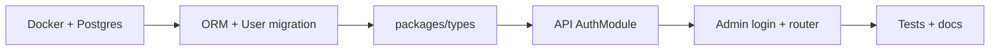

# Authentication — Implementation Plan

**Status: complete** (2026-08-11). Delivered across all five phases below; the next
roadmap item is **Restaurant management** ([README](../../README.md#-roadmap)).

Reference material for what shipped:
[ADR 0001](../decisions/0001-authentication.md) for the decisions,
[API docs](../api/authentication.md) for the endpoints.

## Current State

| Layer            | Status                                                                        |
| ---------------- | ----------------------------------------------------------------------------- |
| API              | `AuthModule` — register, login, me; global `JwtAuthGuard` with `@Public()`    |
| Admin            | react-router with `/login` and a protected dashboard; auth context + provider |
| Database / ORM   | Prisma + PostgreSQL; `users` table migrated (`20250810100000_init_users`)     |
| Docker           | Compose stack for PostgreSQL (`pnpm db:up`)                                   |
| `packages/types` | Shared auth contracts consumed by both apps                                   |
| Tests            | 10 unit specs, 14 e2e specs against real PostgreSQL                           |
| CI               | PostgreSQL service container; migrations, unit, and e2e steps                 |

Deliberately **not** built, with reasoning in the ADR: server-side token revocation
(no logout endpoint), refresh tokens, Redis, `@Roles()` authorization, and any
tenant scoping — the last three all belong with Restaurant management.

---

## Overview

Split authentication into four phases so each piece is reviewable and unblocks **Restaurant management** (which needs users and roles).

---

## Phase 1 — Foundation (prerequisite)

Auth needs persistence before login endpoints.

1. **Docker Compose** — PostgreSQL in `infrastructure/docker/` (Redis can wait unless refresh tokens are stored there).
2. **ORM choice** — Prisma or TypeORM; pick one and stick with NestJS patterns.
3. **`@nestjs/config`** — validated env schema (`DATABASE_URL`, `JWT_SECRET`, etc.).
4. **First migration** — `users` table with email, password hash, name, role, timestamps.

**Exit criteria:** API starts, connects to Postgres, migrations run via one documented command.

---

## Phase 2 — Shared Contracts (`packages/types`)

Define auth shapes once for API + admin:

- `UserRole` (e.g. `owner`, `manager`, `staff`)
- `LoginRequest`, `RegisterRequest`
- `AuthUser` (public user, no password)
- `AuthTokens` or session response type

**Exit criteria:** Both apps import types from `@altora/types` with no duplication.

---

## Phase 3 — API Auth Module

NestJS module with:

| Endpoint              | Purpose                                   |
| --------------------- | ----------------------------------------- |
| `POST /auth/register` | Create account (owner signup for now)     |
| `POST /auth/login`    | Issue JWT (or session cookie)             |
| `GET /auth/me`        | Current user                              |
| `POST /auth/logout`   | Invalidate token/session (optional in v1) |

Also:

- `@nestjs/passport` + JWT strategy
- `JwtAuthGuard` globally, `@Public()` on health/login
- `@CurrentUser()` decorator
- bcrypt password hashing
- DTO validation with existing `ValidationPipe`

**Exit criteria:** Register → login → `/auth/me` works via curl/Postman; protected routes return 401 without a token.

---

## Phase 4 — Admin Auth UI

1. Add **react-router-dom** — `/login` (public), `/` (protected).
2. **Auth context** — store token, call `/api/auth/me`, redirect on 401.
3. **Login page** — minimal form (email/password); reuse `@altora/ui` when primitives exist.
4. **Protected layout** — replace the static shell with a gated dashboard shell.

**Exit criteria:** User can log in in the browser and reach a protected home route; logged-out users are redirected to `/login`.

---

## Phase 5 — Tests & Docs

- API e2e: register → login → me → 401 without token
- ADR in `docs/decisions/`: JWT vs session, role model, multi-tenant user scope
- Auth endpoints in `docs/api/`
- CI: Postgres service container or test DB strategy

---

## Decisions to Make Upfront

Before coding, pick these to avoid rework:

1. **JWT in header vs httpOnly cookie** — CORS + credentials are already enabled; cookies are safer for XSS, Bearer is simpler for SPA dev.
2. **ORM** — Prisma (DX, migrations) vs TypeORM (Nest-native decorators).
3. **Registration** — open signup vs invite-only for v1 (multi-tenant restaurants usually start invite-only or owner-only register).
4. **Roles in v1** — at minimum `owner` + `staff`; expand when waiter/kitchen dashboards land.

---

## After Authentication

Once auth is checked off, **Restaurant management** naturally follows: tenant/restaurant entity, user–restaurant membership, and restaurant-scoped guards building on the auth layer.

---

## Suggested First Slice

**Phase 1 + Phase 2** (Docker, Postgres, User migration, shared types) — solid base without UI yet.
