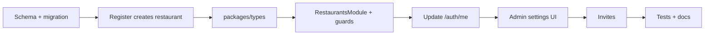

# Restaurant Management — Implementation Plan

Roadmap item after **Authentication** ([README](../../README.md#-roadmap)).

Builds on [ADR 0001](../decisions/0001-authentication.md), which deferred tenant
scoping, per-restaurant roles, and `@Roles()` authorization to this milestone.

**Status:** API tenancy + RBAC is largely in place (`RestaurantsModule`, membership
guards, register creates restaurant + owner). Admin settings UI and invites remain
open. Downstream features that depend on this tenant layer include the
[AI Restaurant Analytics Assistant](./ai-restaurant-analytics-assistant.md).

## Current State

| Layer            | Status                                                                       |
| ---------------- | ---------------------------------------------------------------------------- |
| API              | `RestaurantsModule` + guards; register creates restaurant + owner membership |
| Admin            | Protected dashboard shell; settings / members UI still pending               |
| Database / ORM   | `restaurants` + `restaurant_members`; role lives on membership               |
| `packages/types` | Auth + restaurant / membership contracts                                     |
| Tests            | Auth + restaurants unit and e2e coverage                                      |

Still open in this milestone:

- **Manager** and **staff** accounts via **invites**.
- Admin UI for restaurant settings and member management.

Deliberately **out of scope** for this milestone (later roadmap items):

- Dining halls (**Hall builder**)
- Tables and layout (**Table management**)
- Menus, QR ordering, kitchen/waiter dashboards
- AI analytics assistant (separate plan; may introduce a lean order/product schema
  ahead of full QR ordering)

---

## Overview

Introduce the tenant layer: a `restaurants` entity, a `restaurant_members` join for
per-restaurant roles, guards that scope every request to one restaurant, and a minimal
admin UI to view and edit restaurant settings. Staff onboarding via invites closes
the loop on the `manager` and `staff` roles that exist in the schema but are
unreachable today.

---

## Phase 1 — Data Model & Register Flow

Tenancy belongs in the database before any endpoint reads it.

1. **`restaurants` table** — at minimum:
   - `id` (cuid)
   - `name`
   - `slug` (unique, URL-safe; derived from name on create, editable later)
   - `timezone` (default `UTC`)
   - `currency` (default `USD` or project default)
   - `created_at`, `updated_at`
2. **`restaurant_members` join** — `user_id`, `restaurant_id`, `role` (`UserRole`
   enum reused), `created_at`. Unique on `(user_id, restaurant_id)`.
3. **Migration strategy for `users.role`** — drop the column once membership is
   authoritative, or keep it temporarily and stop reading it. **Recommended:** remove
   `users.role` in the same migration that adds `restaurant_members`, so there is one
   source of truth from day one.
4. **Register transaction** — `POST /auth/register` creates, atomically:
   - `User`
   - `Restaurant` (name derived from owner name or a new optional `restaurantName`
     field on the register DTO — decide upfront)
   - `RestaurantMember` with role `owner`
5. **Backfill** — not needed if no production data; document that existing dev DBs
   must be reset or manually migrated.

**Exit criteria:** Fresh register via API creates three rows; migration runs via
`pnpm db:migrate`; Prisma client reflects new models.

---

## Phase 2 — Shared Contracts (`packages/types`)

Define restaurant shapes once for API + admin:

- `Restaurant` — public restaurant fields (no internal ids beyond `id`/`slug`)
- `RestaurantMember` — user id, restaurant id, role
- `RestaurantSettings` or nested `settings` on `Restaurant` (timezone, currency)
- `UpdateRestaurantRequest` — partial settings update
- `CreateRestaurantRequest` — only if separate from register (likely not in v1)
- Extend `AuthUser` or add `AuthSession` — include **active membership**:
  - `restaurant: Restaurant`
  - `role: UserRole` (per-restaurant, not global)
- Invite types (Phase 5): `InviteMemberRequest`, `InviteStatus`, `AcceptInviteRequest`

Keep `UserRole` in sync with the Prisma enum (same rule as auth).

**Exit criteria:** Both apps import restaurant types from `@altora/types` with no
duplication.

---

## Phase 3 — API: Restaurants Module & Authorization

NestJS module with restaurant-scoped access control.

### Endpoints (v1)

| Endpoint                                      | Purpose                                    | Min role           |
| --------------------------------------------- | ------------------------------------------ | ------------------ |
| `GET /restaurants/current`                    | Active restaurant for the logged-in member | any member         |
| `PATCH /restaurants/current`                  | Update name, timezone, currency            | `owner`            |
| `GET /restaurants/current/members`            | List members                               | `owner`, `manager` |
| `DELETE /restaurants/current/members/:userId` | Remove a member                            | `owner`            |

Use **`/restaurants/current`** rather than `:id` in URLs for v1 — each owner has one
restaurant, and the guard resolves membership from the authenticated user. Path-param
restaurant ids can come when multi-restaurant owners or platform admin land.

### Guards & decorators

1. **`RestaurantMemberGuard`** — loads the caller's membership for their active
   restaurant; attaches `restaurant` and `membership` to the request. Returns 403 if
   no membership.
2. **`@Roles(...roles)`** — checks membership role (not `users.role` or JWT claim).
   Composes with the existing global `JwtAuthGuard`.
3. **`@CurrentRestaurant()` / `@CurrentMembership()`** — param decorators for
   handlers.

### Auth integration

- **`GET /auth/me`** — return user plus active `restaurant` and per-restaurant `role`.
- **`JwtPayload`** — optionally add `restaurantId` later; not required if `/me` and
  guards always load from DB (consistent with how role is handled today).
- **Login** — if a user has zero memberships, return 403 with a clear message (edge
  case after a bad migration; normal register path always creates one).

**Exit criteria:** Owner can register, then GET/PATCH `/restaurants/current`; a
`staff` member cannot PATCH settings; unauthenticated requests return 401; a user with
no membership returns 403.

---

## Phase 4 — Admin UI

Replace the dashboard placeholder with a minimal restaurant home.

1. **Extend auth context** — after login, `/auth/me` provides restaurant + role;
   expose via context hook.
2. **Dashboard (`/`)** — show restaurant name, slug, role; link to settings.
3. **Settings page (`/settings`)** — form for name, timezone, currency; PATCH
   `/api/restaurants/current`; owner-only (hide or disable for staff).
4. **Members page (`/settings/members`)** — list members; owner/manager view (can
   defer member removal UI to Phase 5 if invites ship first).
5. **Loading & error states** — follow patterns from `login-page.tsx`.

**Exit criteria:** Owner registers in browser, lands on dashboard showing their
restaurant, edits settings, and sees changes persist after refresh.

---

## Phase 5 — Staff Invites

Close the gap on `manager` and `staff` roles.

1. **`restaurant_invites` table** — `email`, `restaurant_id`, `role`, `token` (hashed
   or opaque id), `expires_at`, `accepted_at`, `invited_by`.
2. **`POST /restaurants/current/invites`** — owner (and optionally manager) invites
   by email + role.
3. **`POST /auth/accept-invite`** — public or authenticated:
   - Existing user with matching email → create membership.
   - New user → register flow with invite token (no self-serve owner signup).
4. **Email delivery** — v1 can log the invite link to console or return the token in
   the API response for dev; wire a real mailer later.
5. **Admin UI** — invite form on members page; copy invite link in dev.

**Exit criteria:** Owner invites a staff email; invitee accepts and can log in with
`staff` role; staff cannot PATCH restaurant settings.

---

## Phase 6 — Tests & Docs

- **Unit:** guards, `@Roles()`, membership service, invite token validation.
- **E2e:** register → restaurant exists → PATCH settings → invite → accept → role
  enforcement → cross-tenant isolation (second owner cannot read first restaurant).
- **ADR 0002** in `docs/decisions/` — tenancy model, role on membership, URL
  scoping strategy, invite flow.
- **API docs** in `docs/api/restaurants.md`.
- **CI:** extend existing Postgres job — no new infrastructure.

---

## Decisions to Make Upfront

Before coding, pick these to avoid rework:

1. **Restaurant name on signup** — extend `RegisterRequest` with `restaurantName`, or
   default to `"${name}'s Restaurant"`. Explicit field is clearer for onboarding.
2. **Remove `users.role` now vs later** — removing in Phase 1 avoids two sources of
   truth; requires updating auth mappers, JWT strategy, tests, and `@altora/types` in
   the same slice.
3. **One restaurant per owner in v1** — yes, per current register semantics; design
   `restaurant_members` so multi-restaurant owners need no schema change later.
4. **Active restaurant selection** — with one restaurant per user, implicit
   `/restaurants/current` is enough; skip `X-Restaurant-Id` header until multi-tenant
   users exist.
5. **Slug rules** — lowercase, hyphenated, unique globally; regenerate on name change
   or freeze slug after create (recommended: freeze — links and QR codes depend on it
   later).
6. **Invite-only staff signup** — keep open owner register; block self-assigning
   `manager`/`staff` (same rule as today for role on register DTO).

---

## After Restaurant Management

Once this milestone is checked off, **Hall builder** naturally follows: halls belong
to a restaurant, and every hall query is already scoped by the tenant layer built
here.

---

## Suggested First Slice

**Phase 1 + Phase 2** (schema, register transaction, shared types) — same pattern as
auth: solid data and contracts without UI yet. Immediately after, ship Phase 3
endpoints so scoping guards exist before any admin UI calls them.

---

## Progress update (implementation status)

- Phase 1 & 2 completed:
  - Prisma models `restaurants` and `restaurant_members` added; `users.role` removed.
  - `POST /auth/register` creates `User`, `Restaurant`, and `RestaurantMember` atomically.
  - `RegisterRequest` now supports `restaurantName` (optional); default naming applied.
  - `Restaurant` includes `slug`, `timezone` (UTC), and `currency` (USD) defaults.
  - Migration file: `apps/api/prisma/migrations/20260813000000_add_restaurants/migration.sql`.
  - Types added to `@altora/types`: `Restaurant`, `RestaurantMember`, `RestaurantSettings`, `UpdateRestaurantRequest`, `AuthSession`.

Next: Phase 3 — Restaurants module, guards, decorators, and endpoints.

### Phase 3 — Implementation plan (detailed)

Split the work into small deliverables with clear exit criteria and tests:

1. RestaurantsModule scaffold
   - Create module, controller, service, and Prisma repository for `restaurant` and `restaurant_members` operations.
   - Endpoints: GET /restaurants/current, PATCH /restaurants/current, GET /restaurants/current/members, DELETE /restaurants/current/members/:userId.
2. Guards & decorators
   - Implement `RestaurantMemberGuard` to load membership and attach `restaurant` and `membership` to request.
   - Implement `@CurrentRestaurant()` and `@CurrentMembership()` param decorators and ensure `@Roles()` checks membership role.
3. Auth integration
   - Update GET /auth/me to include active restaurant and per-restaurant role.
   - Ensure login returns meaningful 403 if user has no membership.
4. Tests & docs
   - Unit tests for guard, decorators, and membership service.
   - E2E flow: register → restaurant exists → PATCH settings → invite (Phase 5) later.
   - Add docs/api/restaurants.md and update ADR if needed.

Acceptance criteria: all endpoints return correct status by role, guards enforce membership, tests pass locally, and API docs added.

### Phase 4 — Implementation plan (detailed)

1. Extend auth context
   - Consume `restaurant` and `role` from `GET /auth/me`.
   - Expose the active restaurant and membership role through the auth context.

2. Dashboard
   - Replace the placeholder dashboard content.
   - Show restaurant name, slug, and current role.
   - Add navigation to restaurant settings.

3. Restaurant settings
   - Create `/settings` page.
   - Add form fields for name, timezone, and currency.
   - Update settings through `PATCH /api/restaurants/current`.
   - Make settings editing owner-only.

4. Members
   - Create `/settings/members`.
   - Display restaurant members and their roles.
   - Allow owner and manager to view the member list.
   - Defer invitations and member removal UI details to Phase 5 where appropriate.

5. Loading and error states
   - Follow existing patterns from `login-page.tsx`.
   - Handle loading, validation, and API errors consistently.

6. Tests
   - Add/extend admin UI tests where the project currently has frontend test coverage.
   - Verify owner can view and edit restaurant settings.
   - Verify non-owner users cannot edit restaurant settings.

Acceptance criteria:

- Owner can register in the browser and see their restaurant on the dashboard.
- Dashboard displays restaurant name, slug, and role.
- Owner can edit restaurant name, timezone, and currency.
- Changes persist after page refresh.
- Non-owner users cannot edit restaurant settings.
- Existing API and e2e tests remain green.
